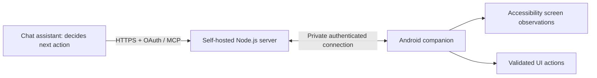

<div align="center">

<p align="center">
  
  
# Agentic Automation on Android

**Hands-free phone control based in ChatGPT.**

From the ChatGPT assistant/app, whenever you need it. A self-hosted Android accessibility companion with MCP tools controlling your phone whenever, wherever.


[](LICENSE)


[Get started](docs/getting-started.md) · [Architecture](docs/current-architecture.md) · [Evaluation plan](evals/README.md) · [Results](docs/results.md) · [Roadmap](docs/roadmap.md)

</div>

**Status: working prototype, Android app 0.8.0.** The real-phone tool path has been exercised during development. No AndroidWorld score or accessibility usability score has been measured yet. Excels in multi-step tasks compared to native Gemini assistant.

<p align="center">
  
  
</p>

Android Agent connects a chat assistant to an Android phone through a server you control. The assistant reads accessible screen text and controls, then launches apps, taps, types, scrolls, and verifies what happened. It is designed with hands-free use in mind; usability for blind and low-vision people.

**Demos:** [Full task end-to-end](docs/media/agentic_android_demo.mp4) · [Conditional task on a real Android phone](docs/media/agentic_android_conditional.mp4)

## What you can ask

- “Open Instagram and tell me my follower count.”
- “Open Messages with Alex and read the latest three messages.”
- “Open SoundCloud and play tuition by Don Toliver.”
- “Open LinkedIn and go to my messages, read the most recent message.”
- “Open Gmail and read out the latest email I've received.”
- "Open Google and search for Penguins"

Gemini assistant prevents use of any unsupported apps. With this setup your agent can navigate your phone the same way you do, it looks then acts.

## When to use it, and when not to

Android Agent reads accessible screen content and operates your phone through taps, typing, scrolling, and swipes. Its strongest use cases involve navigating several screens, completing multiple actions across apps, or checking information before deciding what to do next.

Direct integrations and built-in assistants can be more convenient for simple tasks. Android Agent is useful when the work requires interacting with the phone’s interface. Completion time varies by task, connection, assistant, and app; we haven’t measured a typical time per step yet.

| You want to… | Better to use | Why |
| --- | --- | --- |
| Read or search email, check your calendar, or find a file when a direct integration is available | A connected email, calendar, or file tool | It can retrieve structured information without navigating screens |
| Set a timer, ask about the weather, or perform a supported one-step action | Your phone’s built-in assistant | Fewer interactions and less setup |
| Work with files or applications on your computer | A desktop tool or agent | It operates directly where the work is |
| Enter passwords, authentication codes, or payment details | Handle these yourself | Password fields are excluded, and sensitive information should stay under your control |
| Navigate several screens deep in Android Settings | **Android Agent** | It can follow a sequence of menus, inspect the current settings, and make requested changes |
| Complete several actions across different phone apps | **Android Agent** | One request can describe the sequence instead of requiring you to navigate each app manually |
| Use an app without a suitable direct integration | **Android Agent** | It can interact with the app’s accessible interface |
| Check something first, then act only if a condition is met | **Android Agent** | It can inspect the result and choose the next action based on your instruction |
| Operate your phone hands-free through a connected voice assistant | **Android Agent** | It can carry out supported screen-based tasks through spoken requests |
| Control your phone from your Computer | **Android Agent** | As long as your phone isn't offline and locked, you can control every action necessary from your computer to your phone through ChatGPT|

App accessibility and Android permissions can limit what the agent can do. Your phone must be unlocked, Android Agent must be connected, and your self-hosted server must remain online. Multi-step capability does not guarantee that every workflow will succeed.

### Requests that fit

- *“Open Settings and turn off notifications for these three games.”*  
  Navigate each app’s notification settings and verify the requested changes.

- *“Open Instagram and read the latest three messages from Alex. Then open Spotify and play my Liked Songs9 playlist.”*  
  Complete a sequence across two apps from one request.

- *“Open Instagram and check my follower count. If it’s over 1,000, message Alex ‘We reached the goal!’ Otherwise, just tell me the count 😔.”*  
  Read information first, then act only when the condition is satisfied.

- *“Open my latest email from the ChatGPT recruiter and read the entire body aloud.”*  
  Read an inbox message.

- *“Open Settings, find this app’s permissions, and tell me which permissions are currently enabled. Don’t change anything.”*  
  Inspect a setting several screens deep without modifying it.

Start with short, clearly scoped tasks. Larger requests may need to be split up because phone-control sessions have a five-minute maximum.

The rule of thumb: **use Android Agent when the task needs the phone’s interface, involves several steps or apps, and would otherwise require repeated manual navigation.**

## How it works

**The assistant is the planner.** The server currently does not run its own model or durable background task worker. The first launch or screen read establishes a session automatically when owner-enabled availability is connected. Screen-bound actions use fresh, single-use snapshots. The phone acknowledges actions and returns observations for verification.


The per-step loop — accessible screen text and UI controls in, one validated tool call out, a fresh observation back:

<p align="center">
  

## Capabilities and limits

| Area | Current implementation |
| --- | --- |
| Observation | Accessible text, roles, state, bounds, resource IDs, nearby text; compact or detailed output |
| Actions | App launch, tap, text replacement, keyboard submit, scrolling, single-stroke swipes, Back |
| Efficiency | Combined action-and-observe tool, compact observations and device/server timings |
| App access | Installed apps except Notes, Google Authenticator, Microsoft Authenticator and the companion setup screen |
| Owner control | Local availability switch, notification Stop, task Stop; locked-device checks |
| Session limits | Five-minute maximum; 60-second idle expiry |
| Connection | Windows host, Tailscale private device route, HTTPS OAuth gateway for the assistant |
| History | Up to 50 encrypted local task requests with session durations; not full chat transcripts |
| Not implemented | Screenshot-based visual agent, arbitrary coordinate actions, pinch/multitouch, independent model worker, benchmark harness |

Blocked-app protection is app-level; it does not filter equivalent content inside an allowed browser. The owner must enable Android accessibility and notifications. The Windows host must stay awake and online. Device reboot, app updates and Android background restrictions may require reconnecting.

## Get started

Follow [the setup guide](docs/getting-started.md) for the Windows server, phone permissions and MCP connection. Build the Android APK from source or use a release only after one has been published. Local generated APKs are not stored in the source tree.

The primary exercised path is the connected MCP tools used in development. Availability in a particular mobile or voice assistant surface must be verified separately. Gemini OAuth compatibility has been added, but broad Gemini/mobile/voice reliability is not established.

## Validation

Latest recorded local checks: **60 server tests**, **17 Android JVM tests**, and an emulator smoke check covering the task UI, timer, encrypted history and clearing. These check implementation behavior; they do not measure autonomous task success. See [results and evidence](docs/results.md).

```powershell
cd server
pnpm install --frozen-lockfile --ignore-scripts
pnpm test
```

```powershell
cd android
.\gradlew.bat testDebugUnitTest assembleDebug
```

Requirements: Node.js 22+, pnpm, JDK 17 and Android SDK platform 35. The app targets API 35 and supports API 33+. The new GitHub Actions workflow will run after the project is placed in a GitHub repository; no remote CI pass is claimed yet.

## Repository map

| Path | Purpose |
| --- | --- |
| `android/` | Kotlin companion, accessibility service, encrypted history and Android tests |
| `server/src/mcp/` | Tool definitions, local HTTP transport and OAuth gateway |
| `server/src/connection-server.mjs` | Device connection, sessions and validated command delivery |
| `server/src/security/` | Encrypted saved server state |
| `server/test/` | Automated server and simulated-device tests |
| `evals/` | Evaluation protocol and trial record format; no completed benchmark runs |
| `scripts/` | Windows development and deployment helpers |
| `docs/` | Current guides, evidence, limitations and historical implementation notes |

## Security, contributing and attribution

Read [SECURITY.md](SECURITY.md) before exposing a server and [CONTRIBUTING.md](CONTRIBUTING.md) before submitting changes. Do not commit credentials, phone contents, recordings or local pairing state.

Inspired by Bryan Ramirez-Gonzalez’s [Agentic Automation on iOS](https://github.com/bryanrg22/ios-agent_automation_info) and [Phone Control](https://github.com/bryanrg22/phone-control). Their architectures and reported results are comparison references, not results for this Android implementation.

---
**Eric Xavier Arguelles** · UCI BME '28 · [LinkedIn](https://www.linkedin.com/in/eric-arguelles/) · [GitHub](https://github.com/ericxarguelles)
