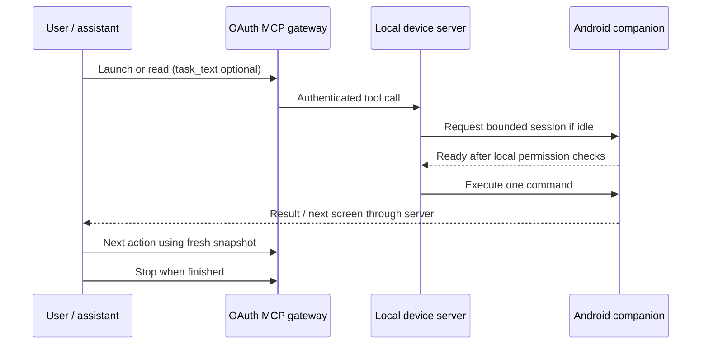

# Current architecture

The model in the connected assistant chooses each action. There is no model API
client or durable agent worker in this server. Twelve MCP tools expose device
status/session controls, observations, and UI actions. App launch or a read can
establish a session automatically after owner-enabled availability and phone
acknowledgement. Every tap/type/scroll/submit/swipe/Back uses a recent snapshot.

The managed Windows stack binds device bridge 8787, MCP 8788, and OAuth gateway
8789 to loopback. Tailscale privately exposes the device route on HTTPS 8443;
Funnel exposes only the gateway on public HTTPS 443. The companion initiates
polling. Windows-account-encrypted configuration and encrypted OAuth state
preserve pairing/grants. AndroidKeyStore protects saved phone configuration and
local task history.

Observations are accessibility text/metadata, not screenshots. Apps that draw
unlabelled custom controls may be inaccessible. Gesture support is a single
stroke inside a validated target, not a general drag-trajectory API.

The history timer covers a phone control session. It excludes pre-session chat
time and does not know model token usage or whether the task actually succeeded.
Transport HTTP 200 can contain a failed tool result. Neither it nor a session
ending should be used as a benchmark pass signal.

The five-minute/60-second-idle limits and app exclusions are product constraints.
Independent background jobs, provider choice, crash-resumable tasks and a visual
fallback are potential future components, not hidden existing features.
